# Знайдені баги

## BUG-1. Для деяких товарів ціна на картці не збігається з ціною, за якою працює фільтр «Вартість»

**Серйозність:** середня.
**Де:** категорія «Чоловіча парфумерія», `/ua/categorys/3218/`.
**Середовище:** makeup.com.ua, desktop Chrome і мобільна версія (емуляція Galaxy S24), 12.11.2026.
**Як знайдено:** автотести цього репозиторію. Приклади 1–3 і випадок з Le Beau Le Parfum я потім повторив вручну, скриншоти в папці [findings/](findings/).

### Суть

Для деяких товарів фільтр шукає не за тією ціною, яку показує картка. Для більшості товарів усе працює правильно: у наших прогонах на сторінці видачі траплялось не більше одного такого товару, а в багатьох діапазонах — жодного. Через це:

- у видачі є картки з ціною **поза** вибраним діапазоном;
- фільтр «від X до X», де X — ціна з картки, цей товар **не знаходить**.

Сама видача, найімовірніше, правильна з погляду фільтра: у товару є інша ціна, яка в діапазон потрапляє. Але покупець бачить на картці ціну, яка не відповідає фільтру.

### Очікуваний результат

- Усі картки у видачі показують ціну в межах вибраного діапазону.
- Фільтр «від X до X» знаходить товар, на картці якого написано X ₴.

### Приклади

Ціни й акції на сайті змінюються протягом дня, тому конкретні числа можуть уже не відтворитися (див. «Як відтворити зараз» нижче).

#### Приклад 1. Hermes Terre d'Hermes Parfum — дешевша пропозиція того самого товару

1. Відкрити категорію, у «Вартість» ввести «Від» 2347, «До» 6442.
2. На картці **Hermes Terre d'Hermes Parfum** ціна **7014 ₴** — вище за 6442.
3. Відкрити список об'ємів на картці:

| Варіант | Ціна |
|---|---|
| 75ml (вибраний на картці за замовчуванням) | 7014 ₴ |
| 75ml з прапорцем ЄС (доставка з ЄС) | 4998 ₴, стара 7080 ₴ |
| 200ml з прапорцем ЄС | 6170 ₴ |

Варіанти за 4998 ₴ і 6170 ₴ у діапазон потрапляють, а картка показує 7014 ₴. Сторінка товару за замовчуванням показувала 4998 ₴, тобто картка й сторінка товару показували різні ціни.

Того ж дня ввечері картка вже показувала 5998 ₴, і з тим самим фільтром проблеми не було.

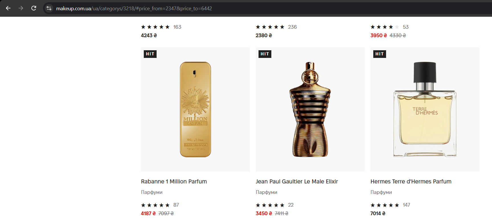
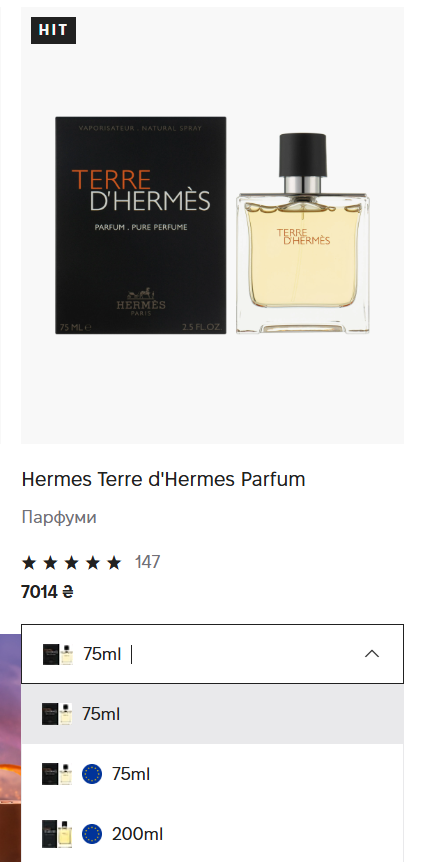
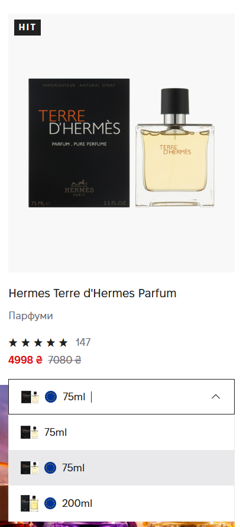

#### Приклад 2. Tiziana Terenzi Kirke — «Додаткові знижки»

1. Відкрити категорію, натиснути готовий діапазон **«1000 ₴ - 5000 ₴»**.
2. На картці **Tiziana Terenzi Kirke** ціна **10473 ₴**.
3. На сторінці товару є блок **«Додаткові знижки»: «Знижка 6442 ₴ діє при покупці разом з будь-яким іншим товаром»**. 10473 − 6442 = **4031**.
4. Фільтр «від 4031 до 4031» знаходить Kirke (на картці 10473 ₴).
5. Фільтр «від 10473 до 10473» показує **«0 товарів»**.

Тобто фільтр порівнює ціну зі знижкою, яка діє тільки при покупці разом з іншим товаром, а картка показує ціну без неї. На картці знижки не видно.

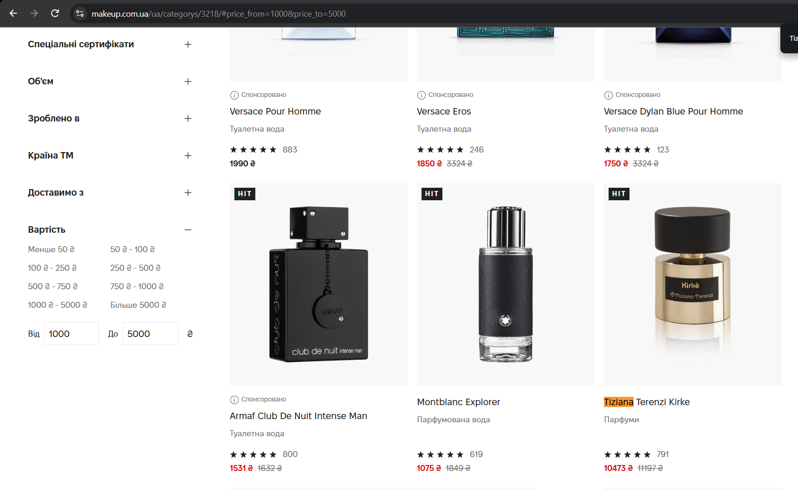
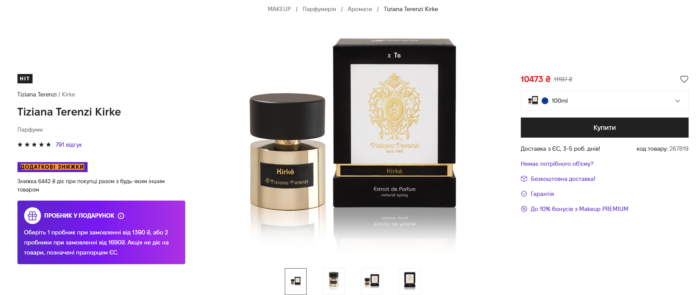
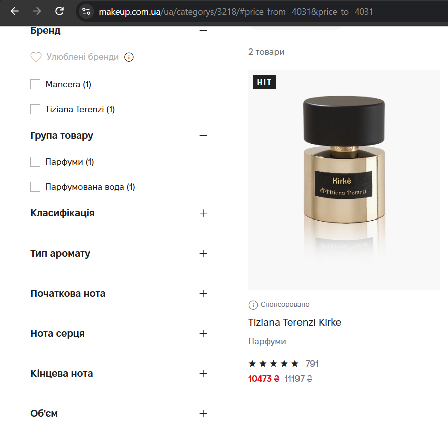
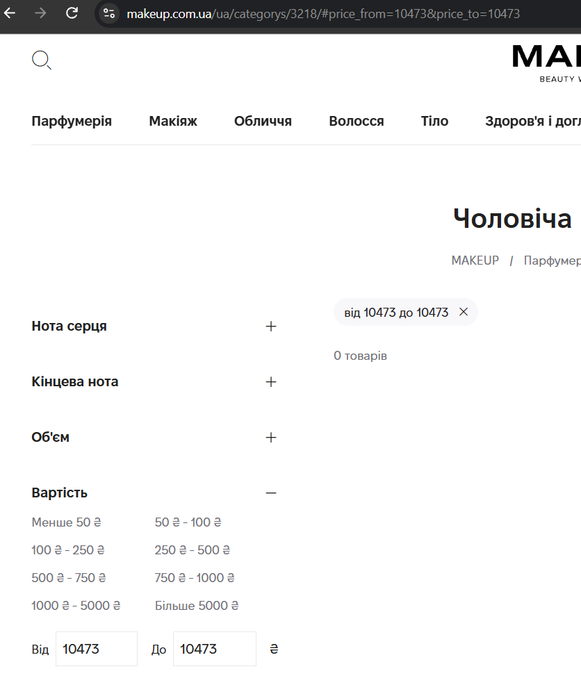

#### Приклад 3. Rabanne 1 Million Parfum — причина невідома

1. Відкрити категорію, ввести тільки «До» **3790**.
2. На картці **Rabanne 1 Million Parfum** ціна **4187 ₴** (стара 7097 ₴).
3. Об'єми на картці: 100ml — 4187 ₴, 200ml — 6173 ₴. Жоден не потрапляє в «до 3790».
4. На сторінці товару 4187 ₴, блоку «Додаткові знижки» **немає**.
5. Фільтр «від 2420 до 2420» знаходить Rabanne (на картці 4187 ₴).
6. Фільтр «від 4187 до 4187» знаходить три інші товари за 4187 ₴, а Rabanne **серед них немає**.

Фільтр бачить цей товар за 2420 ₴. Звідки ця ціна, ззовні з'ясувати не вдалося: ні знижки, ні такого варіанта на сторінці немає.

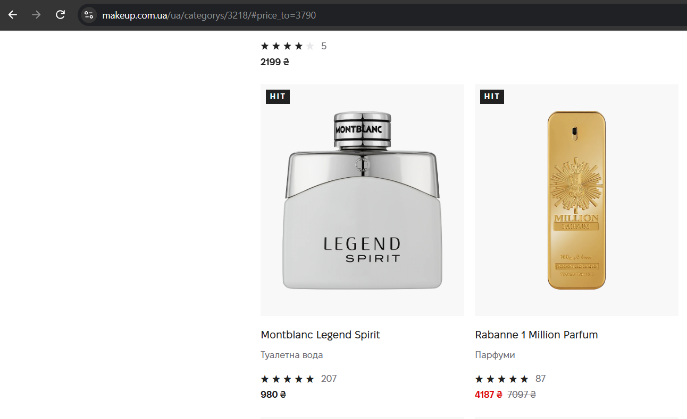
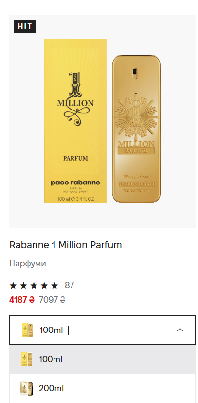
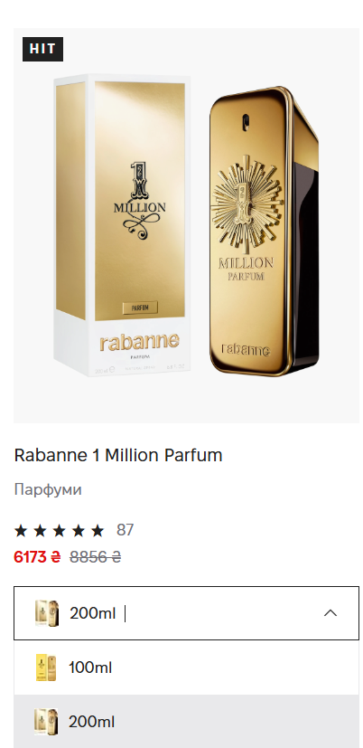
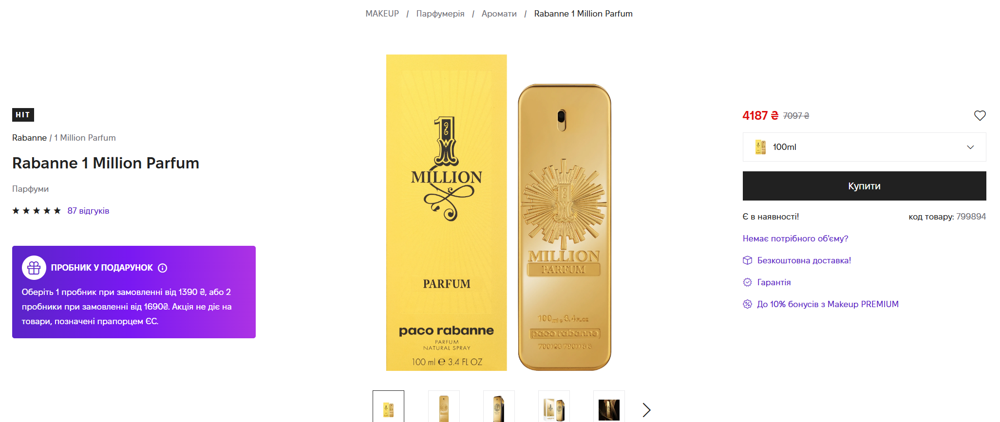
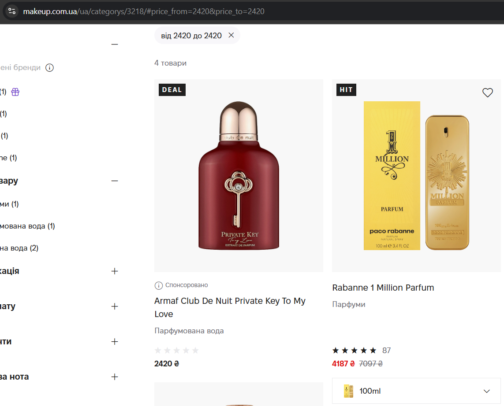
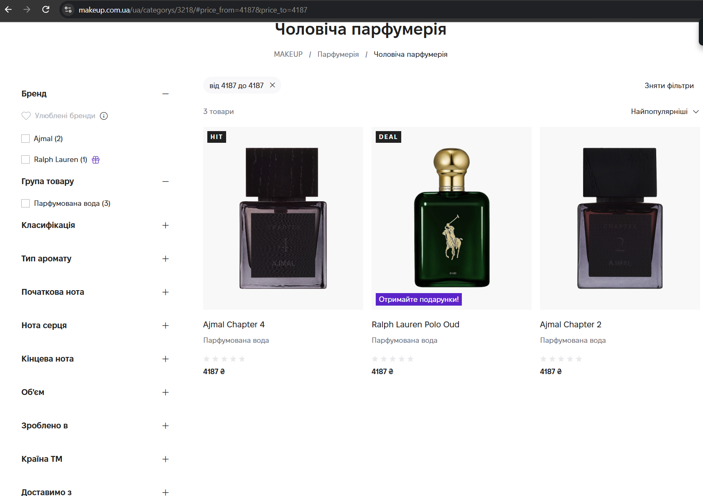

#### Інші випадки того ж типу

- **Jean Paul Gaultier Le Beau Le Parfum** (рекламна картка «Спонсоровано»): фільтр 1000–5951, на картці 7268 ₴, об'єм 125ml. Причину окремо не перевіряв. Рекламні картки тести не перевіряють (див. README).
  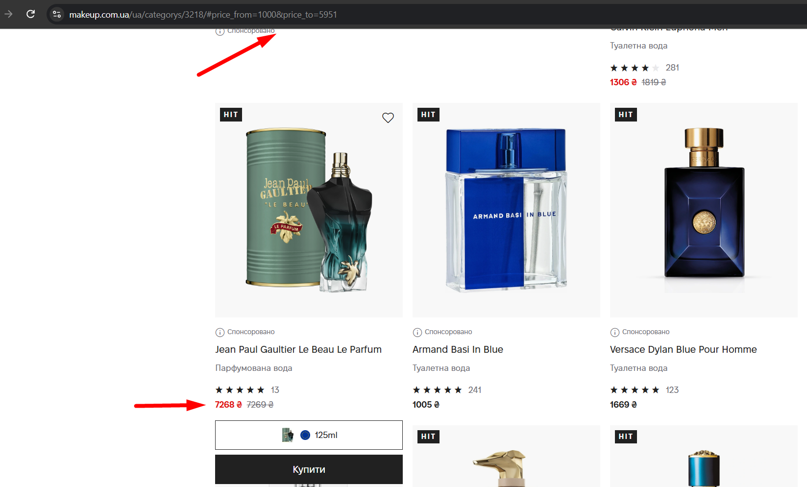
- **Karl Lagerfeld Karl Ikonik Pour Homme**: фільтр 1661–5951, на картці 1640 ₴ — **нижче** нижньої межі. Тобто проблема буває на обох межах. Помічено під час автоматичного прогону, скриншота немає.

### Що відомо про причину

Точна причина невідома, для цього потрібен доступ до бекенду. Видно таке:

- у фільтра своя «ціна товару», і вона може не збігатися з ціною на картці;
- джерела розбіжності, які вдалося побачити: дешевша пропозиція того самого товару (приклад 1), «Додаткові знижки» (приклад 2); у прикладі 3 джерело не видно.

Тому це один баг із кількома прикладами, а не кілька окремих.

### Як відтворити зараз

Конкретні товари залежать від поточних цін і акцій. Щоб знайти актуальний приклад:

1. Запустити тести (див. README). Тест, що впав, показує назву й ціну товару поза діапазоном.
2. Або вручну: застосувати діапазон, знайти картку з ціною поза ним, відкрити сторінку товару і перевірити об'єми та блок «Додаткові знижки».
3. Перевірити фільтром «від X до X» з ціною з картки: товар не знайдеться.

### Як це враховано в тестах

Тести перевіряють ціну на картці — ту, яку бачить покупець. Тому, поки у видачу потрапляє такий товар, відповідний тест падає. У повідомленні про помилку видно назву товару і ціну, наприклад:

```
Received: [{ "title": "Tiziana Terenzi Kirke", "price": 10473 }]
```

12.11.2026 через цей баг падали тести «only to» (Rabanne) і «preset with both bounds ("X - Y")» (Kirke).
